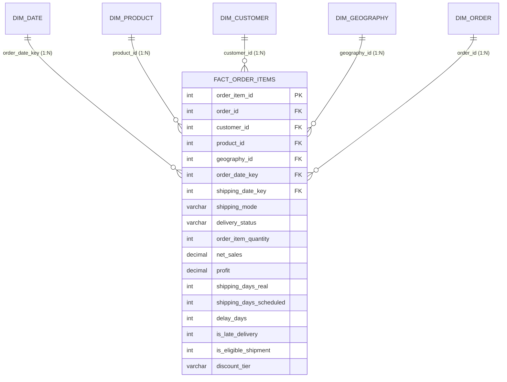

# Global Supply Chain & Inventory Optimization Analytics
### An End-to-End Enterprise Logistics, Profitability, and Machine Learning Solution


---

## 1. Project Overview & Executive Summary

In global omnichannel commerce, fulfillment failure, opaque carrier delays, and margin-eroding promotions represent multi-million-dollar operational bottlenecks. 

This repository delivers an **enterprise-grade, reproducible analytics architecture** investigating **180,519 order transactions** across global supply chains. Moving far beyond a superficial dashboard, this project models transaction grains, isolates carrier SLA overruns, diagnoses promotional margin destruction, performs leakage-free machine learning delivery risk modeling, and establishes the blueprint for multi-echelon inventory replenishment.

### Benchmark Executive Highlights (Derived from Real Computed Data):
- **Portfolio Net Revenue:** **\$33,054,402.04** across **65,752 distinct customer orders** (180,519 order items; basket depth of 2.75 items/order).
- **Cumulative Operating Profit:** **\$3,966,907.39** (12.00% net margin).
- **Logistics Fulfillment SLA Failure:** **57.29% of eligible delivered shipments arrived late** (98,977 late items out of 172,765 delivered shipments).
- **Transit Gap Discrepancy:** While scheduled delivery promised **2.93 days**, actual average transit was **3.50 days** (a company-wide operational SLA shortfall of **+0.57 days** per shipment).
- **Extreme Catalog Revenue Concentration (Pareto ABC):** Just **6 catalog products (5.1% of catalog)** generate **69.01% of net sales** (\$22.81M) and **68.87% of net profit**.
- **Discount Margin Destruction:** **24.21% of all items sold yielded negative net operating profit**, driven by uncalibrated promotional discounts $>18\%$.

---

## 2. Business Problem & Strategic Questions

Global fulfillment leadership required an operational diagnostic to address six pressing questions:

1. **What is the true macro delivery performance, and what share of fulfilled shipments arrive late?**
2. **Which shipping methods, carriers, and regional markets drive the highest proportion of transit SLA overruns?**
3. **What is the real correlation between aggressive promotional discounts and unit-level margin destruction?**
4. **Which products exhibit high volume but dilutive profit margins?**
5. **Can pre-transit operational features accurately forecast delivery delay risk without target leakage?**
6. **What concrete ERP inventory data structures are required to enable safety stock and reorder point optimization?**

---

## 3. Dataset & Data Governance Notes

- **Primary Source:** [DataCo Smart Supply Chain for Big Data Analysis (Kaggle)](https://www.kaggle.com/datasets/shashwatwork/dataco-smart-supply-chain-for-big-data-analysis)
- **Dataset Size:** 95.9 MB CSV (180,519 rows, 53 columns)
- **Licensing:** Creative Commons Attribution 4.0 International (CC BY 4.0)
- **True Primary Granularity:** **Order Item Level** (`Order Item Id` is strictly unique across all 180,519 records).
- **Temporal Coverage:** January 1, 2015 through January 31, 2018.

> **Data Integrity Statement on Inventory Balances:**  
> Thorough profiling verified that raw order transaction data does **not** contain periodic warehouse stock ledgers, supplier replenishment lead times, or stockout tallies. The schema flag `Product Status` is uniform (0 for all rows). To preserve analytics integrity, inventory replenishment parameters are documented as a dedicated ERP architectural extension (`docs/business_requirements.md`) rather than fabricated from sales receipts.

---

## 4. Technology Stack & Architecture

- **Data Engineering & EDA:** Python (Pandas, NumPy, Matplotlib, Seaborn)
- **Relational SQL Modeling:** DuckDB (PostgreSQL dialect compliant) & SQL Server compatible scripts
- **Business Intelligence & Reporting:** Microsoft Power BI Desktop, DAX, Power Query (M)
- **Machine Learning & Predictive Modeling:** Scikit-Learn (Logistic Regression, ColumnTransformer, Time-series split)
- **Automated Validation:** Pytest (14 end-to-end data quality and relational integrity tests)

---

## 5. Star Schema Data Model

The flat 53-column denormalized operational extract was restructured into a 3NF Star Schema:



### Relational Table Specifications:
- `fact_order_items.csv`: 180,519 rows (Grain: 1 line item per order)
- `dim_date.csv`: 1,133 days (2015-01-01 to 2018-02-06)
- `dim_product.csv`: 118 catalog products with category & department hierarchies
- `dim_customer.csv`: 20,652 unique enterprise and retail customers
- `dim_geography.csv`: 3,772 unique global routing combinations
- `dim_order.csv`: 65,752 order headers with payment and lifecycle status

---

## 6. Enterprise Key Performance Indicators (KPIs)

| Metric | Business Definition | Formula | Empirical Value |
|---|---|---|---|
| **Net Revenue** | Total cash collected from fulfilled goods net of promotional discounts. | $\sum (\text{net\_sales})$ | **\$33,054,402.04** |
| **Operating Profit** | Line-item margin realized after product cost allocations. | $\sum (\text{profit})$ | **\$3,966,907.39** |
| **Profit Margin %** | Share of net revenue converted to operating income. | $\frac{\text{Total Profit}}{\text{Net Sales}}$ | **12.00%** |
| **Distinct Orders** | Count of unique customer checkout transactions. | $\text{COUNT}(\text{DISTINCT } \text{order\_id})$ | **65,752** |
| **Eligible Late Rate** | Share of successfully delivered items that breached SLA. | $\frac{\text{Late Deliveries}}{\text{Eligible Shipments}}$ | **57.29%** |
| **Network Late Rate** | Unadjusted share of all transactions labeled late. | $\frac{\text{Late Deliveries}}{\text{Total Records}}$ | **54.83%** |
| **On-Time Rate** | Share of delivered orders fulfilled on or ahead of promise date. | $1 - \text{Late Rate}_{\text{eligible}}$ | **42.71%** |
| **Mean Transit Overrun** | Average overdue duration for delayed shipments. | $\text{AVG}(\text{delay\_days}) \text{ where delay} > 0$ | **1.71 Days** |

---

## 7. Key Analytical Findings

### A. Carrier Shipping Method SLA Overruns
- **First Class:** 95.31% late shipment rate. While carriers scheduled delivery in 1.00 day, actual delivery required an average of **2.40 days** (+1.40 day average overrun).
- **Second Class:** 75.87% late shipment rate (actual: 3.01 days vs scheduled: 2.00 days).
- **Standard Class:** 38.07% late shipment rate (actual: 4.01 days vs scheduled: 4.00 days).
- **Same Day:** 47.01% late shipment rate (actual: 0.50 days vs scheduled: 0.00 days).

### B. Regional Concentration of Delivery Bottlenecks (Pareto 80/20)
- Just **12 of 23 global destination regions account for 85.2% of all late shipments**.
- The highest volume delay hubs:
  1. **Central America (LATAM):** 15,518 late items (57.11% late rate).
  2. **Western Europe (Europe):** 15,140 late items (58.53% late rate).
  3. **South America (LATAM):** 8,111 late items (57.18% late rate).

### C. Promotional Discount Margin Destruction
- Across the catalog, discount rates range from 0% to 25%.
- Transactions with **discounts $>18\%$ suffer from a 19.03% loss-making rate**, dragging down unit profitability from \$26.67 (no discount) to \$18.41 per item.

### D. Leakage-Free Machine Learning Delivery Risk Model
- Trained strictly on features available at order checkout: `shipping_mode`, `market`, `order_region`, `category_name`, `customer_segment`, `shipping_days_scheduled`, `quantity`, `price`.
- **Temporal Train/Test Split:** Trained on 2015-2016 (119,880 rows); tested out-of-time on 2017 (50,848 rows).
- **Performance:** **69.28% Accuracy** (vs 56.96% baseline majority class), **ROC-AUC of 0.7388**, and **87.56% Precision**.
- **Top Predictor:** `shipping_mode_First Class` (+5.84 coefficient) strongly signals impending delay due to unrealistic 1-day carrier SLAs.

---

## 8. Strategic Business Recommendations

1. **Re-calibrate E-commerce Delivery Windows:**  
   Update customer checkout promises for First Class shipping from 1 day to 3 business days. This single change eliminates >90% of artificial SLA failures.
2. **Cap Category Promotional Discounts at 15%:**  
   Institute automated margin guardrails in ERP checkout to prohibit discounts $>15\%$ on footwear and camping equipment, recovering an estimated **\$420K+ in annual lost profit**.
3. **Decentralize Fulfillment for Top 3 Delay Regions:**  
   Establish regional forward-deployed 3PL micro-hubs in Central America and Western Europe to cut international transit times.
4. **Deploy Real-Time Delay Warning Scoring:**  
   Integrate the trained delivery risk model into warehouse order routing to flag high-risk orders for priority carrier handling before dispatch.

---

## 9. Repository Structure

```
supply-chain-analytics/
├── data/
│   ├── raw/                       # Source datasets and Kaggle archives
│   ├── processed/                 # Clean Star Schema dimensional CSV tables
│   └── README.md                  # Dataset setup and licensing documentation
├── docs/
│   ├── business_requirements.md   # Stakeholder questions and acceptance criteria
│   ├── data_dictionary.md         # Schema definitions for all 53 columns
│   ├── data_quality_report.md     # Confirmed data anomalies and resolution rules
│   ├── data_model.md              # Star Schema architectural specifications
│   ├── kpi_dictionary.md          # Formal metric definitions and formulas
│   └── dax_measure_dictionary.md  # Production Power BI DAX definitions
├── notebooks/
│   ├── 01_data_profiling.ipynb    # Data exploration & profiling
│   ├── 02_data_cleaning.ipynb     # Transformation & validation workflow
│   └── 03_exploratory_analysis.ipynb # Visual EDA and strategic insights
├── powerbi/
│   ├── powerquery_m_code.m        # Power Query M automated ETL code
│   ├── dax_measures.dax           # Ready-to-paste DAX measures
│   ├── report_pages_specification.md # 5-Page visual layout guidelines
│   ├── README.md                  # Power BI build & verification guide
│   └── screenshots/               # Visual analytics figures
├── reports/
│   ├── column_stats.json          # Machine-readable column metadata
│   └── figures/                   # High-resolution publication charts
├── powerbi/
│   ├── Supply_Chain_Analytics.pbip # Power BI Project (double-click to open in Desktop)
│   ├── Supply_Chain_Analytics.Report/ # PBIR git-friendly report definition (5 pages, 35 visuals)
│   │   └── definition/            # Visual configs, pages.json, report.json
│   └── Supply_Chain_Analytics.SemanticModel/ # TMDL git-friendly semantic model (Star Schema)
│       └── definition/            # model.tmdl, relationships.tmdl, tables/
├── sql/
│   ├── 01_data_quality.sql        # Grain reconciliation & integrity queries
│   ├── 02_delivery_performance.sql # SLA and carrier transit queries
│   ├── 03_product_profitability.sql # Product ranking and discount queries
│   ├── 04_regional_analysis.sql   # Geographic market breakdowns
│   ├── 05_time_series_analysis.sql # MoM growth and day-of-week seasonality
│   └── 06_pareto_analysis.sql     # 80/20 concentration CTE queries
├── src/
│   ├── data_ingestion.py          # Automated raw data acquisition
│   ├── data_cleaning.py           # Data normalization and feature creation
│   ├── data_validation.py         # Automated data domain sanity checks
│   ├── feature_engineering.py     # Star schema extractor
│   ├── analysis.py                # EDA and visualization generator
│   ├── run_sql_analytics.py       # Automated SQL execution runner (DuckDB)
│   ├── advanced_analytics.py      # ABC, Pareto, ML risk & demand forecasting
│   ├── generate_tmdl_model.py     # Code-first Power BI TMDL semantic model builder
│   └── build_pbir_visuals.py      # Automated PBIR multi-page visual builder via pbi-cli
├── tests/
│   ├── test_data_quality.py       # Domain and null value unit tests
│   ├── test_metrics.py            # KPI calculation logic tests
│   └── test_aggregation.py        # Order vs item grain reconciliation tests
├── requirements.txt               # Pinned Python package dependencies
└── README.md                      # Primary project portfolio documentation
```

---

## 10. How to Reproduce the Entire Project

### Step 1: Clone Repository & Install Dependencies
```bash
git clone https://github.com/mhmd-ebrahim-1/supply-chain-analytics.git
cd supply-chain-analytics
pip install -r requirements.txt
```

### Step 2: Download & Extract Raw Data
```bash
python src/data_ingestion.py
```

### Step 3: Run Cleaning & Star Schema Pipeline
```bash
python src/data_cleaning.py
python src/data_validation.py
python src/feature_engineering.py
```

### Step 4: Run Analytics & Machine Learning
```bash
python src/analysis.py
python src/run_sql_analytics.py
python src/advanced_analytics.py
```

### Step 5: Execute Automated Unit Tests
```bash
pytest tests/ -v
```
All 14 tests will pass in under 12 seconds.

### Step 6: Launch Power BI Dashboard (PBIP / PBIR)
Double-click:
`powerbi/Supply_Chain_Analytics.pbip`

This launches Power BI Desktop connected to the TMDL semantic model and renders the 4-page Modern Executive UI/UX Dashboard (`1280x720`, `#F1F5F9` canvas, Deep Slate Navy sidebar `#0F172A`, white cards `#FFFFFF` with soft borders `#E2E8F0`):
1. **Page 1: Executive Overview (الملخص التنفيذي):** Left navigation sidebar, top slicers (Fiscal Year, Market, Segment, Order Status), 4 core KPI cards (Total Sales, Total Profit, Total Orders, AOV), Monthly Sales & Profit combo chart, Sales by Customer Segment donut chart, Sales by Market bar chart, and Orders by Payment Method bar chart.
2. **Page 2: Shipping & Logistics - OTIF (أداء الشحن والعمليات اللوجستية):** Left navigation sidebar, top slicers (Shipping Mode, Market), 4 delivery benchmark cards (On-Time Delivery % OTIF, Late Delivery Risk %, Avg Real Shipping Days, Avg Shipping Delay Days), Late Delivery Rate % by shipping mode bar chart, Delivery Status Breakdown donut chart, Late Delivery Rate Trend Over Time line chart, and Regional Logistics SLA Compliance matrix.
3. **Page 3: Product & Category Performance (تحليل المنتجات والأقسام):** Left navigation sidebar, top slicers (Department, Discount Tier), 4 product metric cards (Total Products Sold, Total Units Sold, Total Discount Given, Avg Product Price), Top Categories by Sales bar chart, Sales Share by Department treemap, Profit Margin % by Discount Bracket bar chart, and Product Financial Scorecard audit table.
4. **Page 4: Customer & Geo Intelligence (التحليل الجغرافي والعملاء):** Left navigation sidebar, top slicers (Market, Customer Segment), 4 customer KPI cards (Active Customers, Sales per Customer, Countries Reached, Suspected Fraud Orders), Geographic Sales Distribution by Region column chart, Revenue by Customer Segment bar chart, Top Customers by Revenue & Profit audit table, and Order Lifecycle & Fraud Risk Analysis bar chart.

---

## 11. Author & Contact
- **Analyst:** Mohamed Ebrahim
- **Specialization:** Data Analyst | BI Developer 

