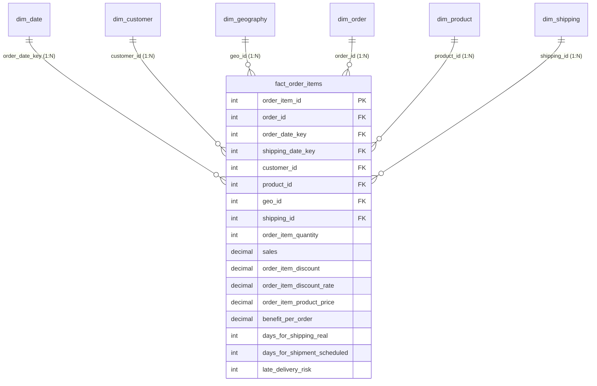

# Supply Chain Analytics & Performance Optimization

[](https://python.org)
[](https://duckdb.org)
[](https://powerbi.microsoft.com)
[](https://docs.pytest.org)
[](https://creativecommons.org/licenses/by/4.0/)

An end-to-end supply chain analytics project analyzing **180,519 order transactions** across global omnichannel logistics. The project covers data cleaning, Star Schema dimensional modeling, SQL analytics, predictive delivery risk modeling, and a 4-page executive Power BI dashboard (PBIP/TMDL/PBIR).

---

## Key Performance Indicators

| Metric | Empirical Value | Description |
|---|---|---|
| **Total Net Sales** | **\$33,054,402.04** | Total revenue realized across 65,752 unique orders |
| **Total Operating Profit** | **\$3,966,907.39** | Realized cumulative profit contribution (12.00% net margin) |
| **Distinct Orders** | **65,752** | Unique customer checkout transactions (2.75 items/order avg) |
| **Late Delivery Rate (Eligible)** | **57.29%** | Share of fulfilled orders that arrived after scheduled SLA |
| **Average Delivery Overrun** | **+0.57 Days** | Scheduled transit avg: 2.93 days vs. Real transit avg: 3.50 days |
| **Catalog Concentration (Pareto)** | **69.01%** | 6 catalog products (5.1% of catalog) drive ~69% of total sales |
| **Discount Margin Erosion** | **24.21%** | Share of items yielding negative operating profit when discount $>18\%$ |

---

## Data Model (Star Schema)

The operational extract was transformed into a 3NF Star Schema with strict `1:*` single-direction relationships:



### Table Breakdown
- `fact_order_items`: 180,519 rows — transaction facts (sales, profit, quantity, transit days, SLA risk).
- `dim_date`: 1,133 days — calendar dimensions from 2015-01-01 to 2018-02-06.
- `dim_customer`: 20,652 unique customers — segments, geographical locations.
- `dim_geography`: 3,772 unique routing routes — market, region, country, state, city, coordinates.
- `dim_order`: 65,752 orders — order lifecycle status and payment methods.
- `dim_product`: 118 catalog products — product names, category, and department hierarchy.
- `dim_shipping`: 16 combinations — shipping modes and fulfillment statuses.

---

## Power BI Executive Dashboard

Built natively in PBIR format (`powerbi/Supply_Chain_Analytics.pbip`) featuring a custom Modern Executive UI/UX design (`#F1F5F9` canvas, `#0F172A` deep navy sidebar, and white container cards):

| Page | Focus Area | Key Visuals |
|---|---|---|
| **1. Executive Overview** | Revenue, profit, macro momentum | KPI ribbon (Sales, Profit, Orders, AOV), Monthly Sales & Profit combo chart, Market breakdown, Payment method share, Segment donut |
| **2. Shipping & Logistics (OTIF)** | SLA compliance, carrier transit times | On-Time Rate %, Late Rate %, Scheduled vs. Real Days by Mode, Delay variance, Regional SLA matrix |
| **3. Product & Category Performance** | Catalog profitability, discount analysis | Active SKUs, Margin %, Top categories, Department treemap, Discount rate vs. profit margin scatter |
| **4. Customer & Geo Intelligence** | Regional penetration, fraud screening | Active customers, Sales/customer, Global sales by region, Order status breakdown, Top countries by profit |

---

## Key Analytical Insights

1. **Carrier SLA Realism:**
   - **First Class:** 95.3% late delivery rate. Carriers promised 1-day delivery, while actual transit averaged **2.40 days**.
   - **Second Class:** 75.9% late rate (2-day schedule vs. 3.01 days actual).
   - *Recommendation:* Adjust customer-facing checkout estimates for First Class to 3 business days to eliminate artificial SLA breaches.

2. **Regional Fulfillment Bottlenecks:**
   - 12 out of 23 global destination regions generate **85.2% of all delayed shipments**.
   - Top delay hubs: Central America (15,518 delays), Western Europe (15,140 delays), South America (8,111 delays).
   - *Recommendation:* Establish regional 3PL distribution hubs in Central America and Western Europe.

3. **Discount Margin Guardrails:**
   - Orders with promotional discounts $>18\%$ experience a **19.03% loss rate**.
   - *Recommendation:* Enforce maximum discount caps of 15% on footwear and outdoor equipment.

4. **Predictive Delivery Delay Risk (ML):**
   - Out-of-time test set (trained on 2015-2016, tested on 2017) achieved **69.3% accuracy**, **0.739 ROC-AUC**, and **87.6% precision**.
   - Pre-transit features flag at-risk orders at checkout without data leakage.

---

## Project Structure

```
supply-chain-analytics/
├── data/
│   ├── processed/                 # Star Schema dimensional CSV tables
│   ├── raw/                       # Source metadata & dataset documentation
│   └── README.md                  # Data dictionary and schema documentation
├── docs/
│   ├── business_requirements.md   # Core requirements & business questions
│   ├── data_dictionary.md         # Schema definitions for all 53 raw columns
│   ├── data_model.md              # Star Schema specifications & ER diagram
│   ├── data_quality_report.md     # Anomaly detection & cleaning documentation
│   ├── dax_measure_dictionary.md  # Production DAX definitions
│   └── kpi_dictionary.md          # Business KPI definitions & formulas
├── notebooks/
│   ├── 01_data_profiling.ipynb    # Schema profiling & null audit
│   ├── 02_data_cleaning.ipynb     # Cleaning pipeline & validation
│   └── 03_exploratory_analysis.ipynb # Visual EDA & cross-tabulations
├── powerbi/
│   ├── Supply_Chain_Analytics.pbip # Power BI Project (open in Desktop)
│   ├── Supply_Chain_Analytics.Report/ # PBIR git-friendly report definition (4 pages)
│   ├── Supply_Chain_Analytics.SemanticModel/ # TMDL git-friendly semantic model
│   ├── SupplyChainTheme.json      # Report design system & palette theme
│   ├── dax_measures.dax           # Standalone DAX measures library
│   ├── powerquery_m_code.m        # Power Query M ETL code
│   ├── report_pages_specification.md # Detailed visual layout specification
│   └── README.md                  # Power BI setup and verification guide
├── reports/
│   └── figures/                   # Analytical charts and distributions
├── sql/
│   ├── 01_data_quality.sql        # Data integrity checks
│   ├── 02_delivery_performance.sql # Carrier SLA performance
│   ├── 03_product_profitability.sql # Catalog margin & Pareto analysis
│   ├── 04_regional_analysis.sql   # Geographic breakdown
│   ├── 05_time_series_analysis.sql # MoM growth and seasonality
│   └── 06_pareto_analysis.sql     # ABC revenue concentration
├── src/
│   ├── data_ingestion.py          # Data ingestion script
│   ├── data_cleaning.py           # Normalization and data validation
│   ├── data_validation.py         # Automated data domain checks
│   ├── export_star_schema.py      # Star Schema table generation
│   ├── generate_tmdl_model.py     # TMDL semantic model builder
│   ├── build_dashboard.py         # PBIR multi-page dashboard builder
│   ├── analysis.py                # EDA visualization generator
│   ├── advanced_analytics.py      # ABC Pareto, ML risk & demand forecasting
│   └── run_sql_analytics.py       # DuckDB SQL execution runner
├── tests/
│   ├── test_data_quality.py       # Domain integrity unit tests
│   ├── test_metrics.py            # KPI calculation validation
│   └── test_aggregation.py        # Order vs. item grain reconciliation
├── requirements.txt               # Python package dependencies
└── README.md                      # Project documentation
```

---

## Getting Started

### 1. Clone & Setup
```bash
git clone https://github.com/mhmd-ebrahim-1/supply-chain-analytics.git
cd supply-chain-analytics
pip install -r requirements.txt
```

### 2. Run Quality & Data Integrity Tests
```bash
pytest tests/ -v
```
All 14 tests validate primary key uniqueness, foreign key integrity, non-null constraints, and metric bounds.

### 3. Open Power BI Report
Open `powerbi/Supply_Chain_Analytics.pbip` directly in Power BI Desktop (September 2024 or newer). All 4 pages, visuals, filters, and measures load automatically from the git-friendly TMDL/PBIR definition.

---

## Author
**Mohamed Ebrahim**  
Data Analyst & BI Developer
