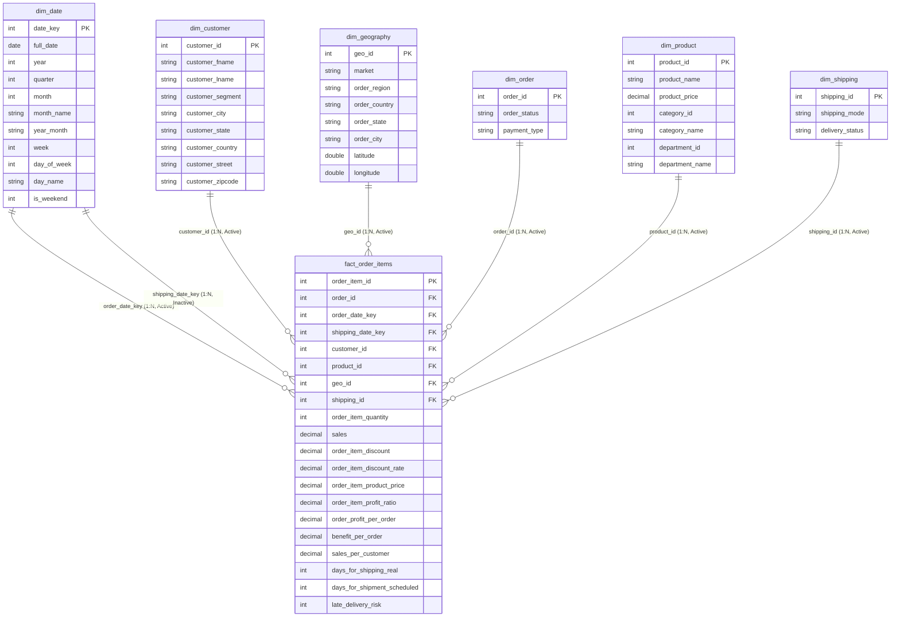

# Analytical Data Model Specification: Supply Chain Star Schema

## 1. Schema Overview

The operational supply chain transaction data is structured into a 3NF Star Schema optimized for high-performance Power BI reporting (TMDL/PBIR) and SQL analytics.

---

## 2. Table Specifications & Cardinalities

| Table Name | Type | Grain | Row Count | Primary Key | Description |
|---|---|---|---|---|---|
| **`fact_order_items`** | Fact | Line item per order | 180,519 | `order_item_id` | Core transaction metrics (sales, profit, quantity, shipping days, delivery risk). |
| **`dim_date`** | Dimension | Calendar day | 1,133 | `date_key` | Calendar dimensions covering 2015-01-01 to 2018-02-06. |
| **`dim_customer`** | Dimension | Customer account | 20,652 | `customer_id` | Customer profile, segment, and billing address. |
| **`dim_geography`** | Dimension | Fulfillment routing | 3,772 | `geo_id` | Market, regional destination, coordinates. |
| **`dim_order`** | Dimension | Order header | 65,752 | `order_id` | Order status and payment mechanism. |
| **`dim_product`** | Dimension | Catalog SKU | 118 | `product_id` | Product catalog with category and department hierarchy. |
| **`dim_shipping`** | Dimension | Shipping profile | 16 | `shipping_id` | Shipping mode and final delivery status combinations. |

---

## 3. Relationships & Referential Integrity

- All relationships follow `1:*` cardinality with **Single** cross-filter direction pointing from Dimension to Fact.
- Full referential integrity verified: **0 orphaned foreign keys** across all 180,519 fact records.
