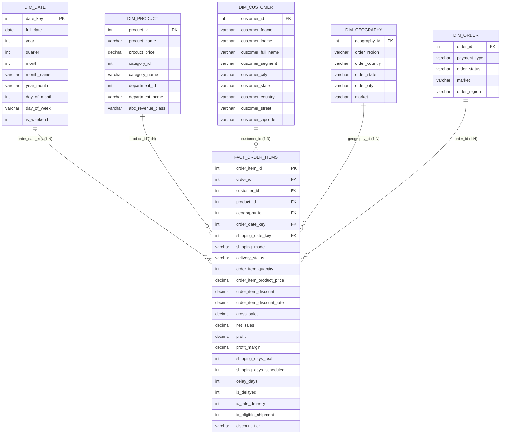

# Analytical Data Model Specification: Supply Chain Star Schema

## 1. Architectural Architecture Overview

To support enterprise reporting in Power BI and high-performance SQL analytical queries, the flat, denormalized 53-column DataCo dataset was engineered into an industry-standard **Star Schema**.

---

## 2. Table Specifications & Cardinalities

### Fact Table: `fact_order_items`
- **Granularity:** One record per physical item in an order (`Order Item Id`).
- **Row Count:** 180,519 rows.
- **Primary Key:** `order_item_id`.
- **Foreign Keys:**
  - `order_id` $\rightarrow$ `dim_order.order_id`
  - `product_id` $\rightarrow$ `dim_product.product_id`
  - `customer_id` $\rightarrow$ `dim_customer.customer_id`
  - `geography_id` $\rightarrow$ `dim_geography.geography_id`
  - `order_date_key` $\rightarrow$ `dim_date.date_key`
  - `shipping_date_key` $\rightarrow$ `dim_date.date_key` (inactive or secondary role-playing relationship)

### Dimension 1: `dim_date`
- **Granularity:** One row per calendar day from 2015-01-01 through 2018-02-06.
- **Row Count:** 1,133 days.
- **Primary Key:** `date_key` (Format: `YYYYMMDD`).
- **Hierarchy:** `Year` $\rightarrow$ `Quarter` $\rightarrow$ `Month` $\rightarrow$ `Date`.

### Dimension 2: `dim_product`
- **Granularity:** One row per catalog item.
- **Row Count:** 118 catalog products.
- **Primary Key:** `product_id`.
- **Hierarchies:** `Department Name` $\rightarrow$ `Category Name` $\rightarrow$ `Product Name`.

### Dimension 3: `dim_customer`
- **Granularity:** One row per unique customer.
- **Row Count:** 20,652 customers.
- **Primary Key:** `customer_id`.
- **Attributes:** `customer_full_name`, `customer_segment` (Consumer, Corporate, Home Office), address details.

### Dimension 4: `dim_geography`
- **Granularity:** Unique destination route combinations.
- **Row Count:** 3,772 geographic routes.
- **Primary Key:** `geography_id`.
- **Hierarchy:** `Market` $\rightarrow$ `Order Region` $\rightarrow$ `Order Country` $\rightarrow$ `Order State` $\rightarrow$ `Order City`.

### Dimension 5: `dim_order`
- **Granularity:** One row per order header.
- **Row Count:** 65,752 orders.
- **Primary Key:** `order_id`.
- **Attributes:** `payment_type`, `order_status`.

---

## 3. Relationship Rules & Power BI Configuration

1. **Directionality:** All relationships are configured as **Single Direction (1 to Many)**, flowing from Dimension (1) to Fact (*).
2. **No Bi-directional Cross-Filtering:** Disabling bidirectional cross-filtering prevents ambiguous filter paths and Cartesian product overhead.
3. **No Many-to-Many Relationships:** Every dimension table possesses an audited, strictly unique primary key.
4. **Role-Playing Date Handling:** The primary active relationship links `dim_date[date_key]` $\rightarrow$ `fact_order_items[order_date_key]`. The shipping date relationship is inactive and activated in DAX using `USERELATIONSHIP(dim_date[date_key], fact_order_items[shipping_date_key])`.

---

## 4. Totals Reconciliation & Integrity Verification

| Metric | Raw Flat Dataset | Clean Star Schema | Reconciliation Delta | Status |
|---|---|---|---|---|
| **Total Fact Rows** | 180,519 | 180,519 | 0 | **EXACT MATCH** |
| **Total Gross Revenue** | \$35,779,438.16 | \$35,779,438.16 | \$0.00 | **EXACT MATCH** |
| **Total Net Sales** | \$33,054,402.04 | \$33,054,402.04 | \$0.00 | **EXACT MATCH** |
| **Total Realized Profit** | \$3,966,907.39 | \$3,966,907.39 | \$0.00 | **EXACT MATCH** |
| **Unique Order Count** | 65,752 | 65,752 | 0 | **EXACT MATCH** |
| **Late Deliveries Count** | 98,977 | 98,977 | 0 | **EXACT MATCH** |
| **Eligible Shipments Count** | 172,765 | 172,765 | 0 | **EXACT MATCH** |
